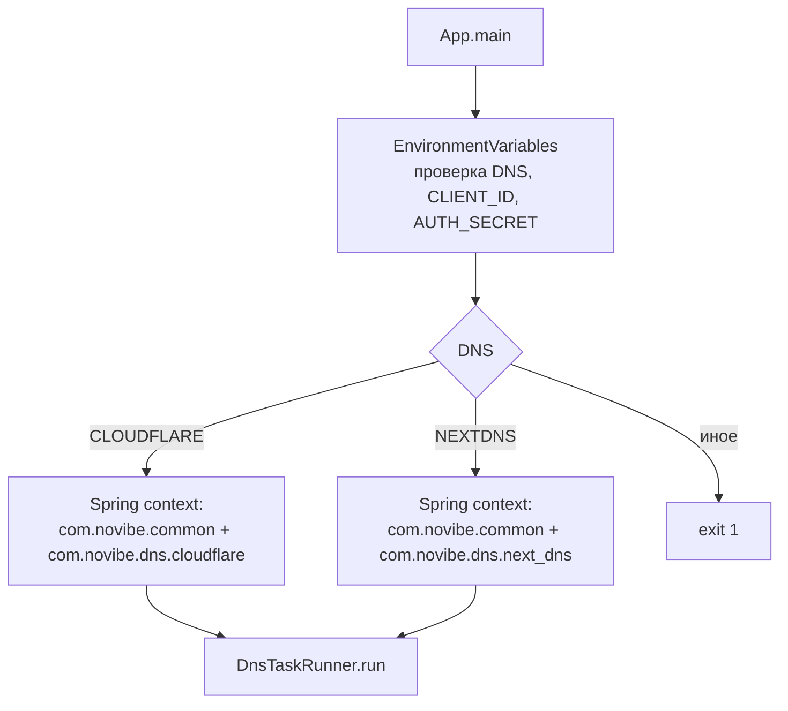
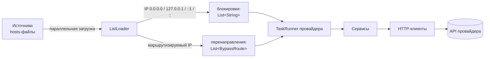

# Архитектура

Консольное приложение на Java 25 без веб-сервера. Spring используется только
как DI-контейнер (`spring-context`), Gson — для JSON, Lombok — для шаблонного
кода. HTTP — стандартный `java.net.http.HttpClient`.

## Структура пакетов

```
com.novibe
├── App                              точка входа, выбор провайдера
├── common                           общий код, загружается всегда
│   ├── DnsTaskRunner                интерфейс сценария провайдера
│   ├── HttpRequestSender            базовый HTTP-клиент к API провайдера
│   ├── config
│   │   ├── AppConfig                бины: Gson, HttpClient, sessionId
│   │   └── EnvironmentVariables     чтение и проверка переменных окружения
│   ├── data_sources                 загрузка и разбор hosts-файлов
│   │   ├── HostsLine                разбор одной строки, проверка IP и доменов
│   │   ├── ListLoader<T>            скачивание и общий конвейер разбора
│   │   ├── HostsBlockListsLoader    → List<String> (домены)
│   │   └── HostsOverrideListsLoader → List<BypassRoute(ip, website)>
│   ├── base_dto/Jsonable            toJson() для тел запросов
│   ├── exception/DnsHttpError       ошибка HTTP с кодом и телом ответа
│   └── util                         Log, EnvParser, FunctionWrapper
└── dns
    ├── cloudflare                   загружается при DNS=CLOUDFLARE
    │   ├── CloudflareTaskRunner     сценарий
    │   ├── service/ListService      списки: чанки, создание, удаление
    │   ├── service/RuleService      правила: block/override, precedence
    │   └── http/                    RequestCloudflare, *Client, dto/
    └── next_dns                     загружается при DNS=NEXTDNS
        ├── NextDnsTaskRunner        сценарий
        ├── service/                 NextDnsDenyService, NextDnsRewriteService
        └── http/                    клиенты, NextDnsRateLimitedApiProcessor, dto/
```

## Запуск и выбор провайдера



Провайдер выбирается **сканированием только его пакета**: в контексте всегда
ровно одна реализация `DnsTaskRunner`, и `context.getBean(DnsTaskRunner.class)`
однозначен. Отдельных профилей или условных бинов нет.

## Поток данных



### Конвейер `ListLoader.fetchWebsites`

1. Для каждой ссылки — подзадача в `StructuredTaskScope` (preview API);
   загрузка параллельная, результаты собираются в порядке ссылок. Для загрузки
   используется собственный `HttpClient` загрузчика с `Redirect.NORMAL`
   (общий клиент для API провайдеров редиректы не выполняет). Ответ не 2xx или
   сетевая ошибка → `Log.fail` и `System.exit(1)` до любых изменений у провайдера.
2. `parse(List<String>)` (пакетный доступ, покрыт тестами): строки →
   `HostsLine.stripComment` → `HostsLine.parse` (IP + домены, проверка формата)
   → `toObjects(HostsLine)` подкласса (`Stream`, одна строка может дать
   несколько результатов) → `distinct`.
3. Поток последовательный и упорядоченный, поэтому порядок источников
   сохраняется — на нём держится правило «первый источник выигрывает».

`HostsLine` решает, к чему относится строка: `isBlock()` — IP из набора
блокировок, `isOverride()` — не блокировка и маршрутизируемый адрес
(не loopback, мультикаст, link-local и т. п.).

## Сценарий Cloudflare

`CloudflareTaskRunner.run()`:

1. Загрузить блокировки и перенаправления.
2. `RuleService.obtainExistingRules` → `removeOldRules`: удалить правила
   с префиксом `Rules set by script` и чужим `sessionId`. Возвращается список
   оставшихся правил — он нужен для подбора precedence.
3. `ListService.removeOldLists`: то же для списков, удаление параллельно на
   виртуальных потоках. Правила удаляются раньше списков, потому что правило
   ссылается на список.
4. Блокировки: чанки по 1000 → списки (параллельно) → одно правило `block`,
   `traffic` = `any(dns.domains[*] in $<id1>) or any(...)`.
5. Перенаправления: `formOverrideListRequestsByIp` (дедупликация доменов через
   `putIfAbsent`, группировка по IP) → списки по каждому IP → по одному правилу
   `override` на IP, создаются параллельно в `StructuredTaskScope`.

**`sessionId`** — бин `String` (случайный UUID) из `AppConfig`, внедряется по типу.
Пишется в `description` всех создаваемых объектов; это защищает от удаления
объектов, созданных в текущем запуске.

**`PrecedenceCounter`** — синхронизированный счётчик, выдающий значения начиная
с 1 и пропуская precedence оставшихся правил. Появился в `fca2b12`, чтобы
параллельное создание правил не давало коллизий.

## Сценарий NextDNS

`NextDnsTaskRunner.run()`:

0. `NEXTDNS_CLEAR_ALL=true` → `removeAll` для denylist и rewrites. Если флага нет
   и оба источника пусты — сообщение «nothing to do», ничего не удаляется.
1. `BLOCK` задан → загрузить → `dropExistingDenys` (исключить активные
   существующие) → `saveDenyList`.
2. `REDIRECT` задан → загрузить → `buildNewRewrites` (Map домен → запрос,
   первый IP выигрывает) → `cleanupOutdated` (удалить rewrites с изменённым IP,
   выкинуть из запросов уже актуальные) → `saveRewrites`.

Все пакетные операции идут через `NextDnsRateLimitedApiProcessor.callApi`:
очередь, последовательная отправка, на `429`/`524` — возврат запроса в очередь
и пауза 60 секунд. Параллелизма нет намеренно — лимит API ~60 запросов в минуту.

## HTTP-слой

`HttpRequestSender` — абстрактный базовый класс. Подкласс задаёт:

| Метод | Cloudflare | NextDNS |
|---|---|---|
| `apiUrl()` | `https://api.cloudflare.com/client/v4/accounts/{CLIENT_ID}/gateway` | `https://api.nextdns.io/profiles/{CLIENT_ID}` |
| `authHeaderName()` | `Authorization` | `X-Api-Key` |
| `authHeaderValue()` | `Bearer {AUTH_SECRET}` | `{AUTH_SECRET}` |
| `react401()` / `react403()` | сообщения о токене и правах | `Invalid api key!` |

Поведение базового класса:

- семафор на 100 одновременных запросов на экземпляр клиента (освобождается в `finally`);
- `401`/`403` → вызвать `react40x()` и `System.exit(1)`;
- прочие коды `> 299` → исключение `DnsHttpError` (код, тело ответа, тело запроса);
- пустое тело → `null`, иначе Gson-десериализация в указанный тип.

Тела запросов реализуют `Jsonable`. Его статическое поле `mapper` берёт `Gson`
из `App.context`, поэтому DTO с `toJson()` можно использовать только после
создания контекста.

## Ключевые решения и компромиссы

| Решение | Причина | Цена |
|---|---|---|
| Cloudflare: полное пересоздание | Простота, не нужно вычислять разницу | Неатомарность, много запросов на каждый запуск |
| NextDNS: инкрементальное обновление | Лимит API делает пересоздание непрактичным | Удалённые из источника домены не удаляются из профиля |
| Пометка объектов Cloudflare префиксом имени + sessionId | Не трогать чужие объекты | Пользователь может случайно использовать тот же префикс |
| `System.exit` при фатальных ошибках | Скрипт одноразовый, запускается в CI | Сценарии с HTTP сложно тестировать |
| NextDNS: очистка только по `NEXTDNS_CLEAR_ALL` | Записи скрипта неотличимы от ручных | Устаревшие записи удаляются только полной очисткой |
| Конфигурация через `static final` поля | Минимум кода | Переменные читаются при загрузке класса, подменить в тестах нельзя |
| Preview API Java 25 | Структурированная конкурентность | Нужен `--enable-preview` при сборке и запуске |

Модульные тесты покрывают чистую логику: разбор hosts (`HostsLine`,
`ListLoader.parse`), `EnvParser`, разбиение на чанки (`ListService.cutChunks`).
Сценарии с HTTP тестами не покрыты.
